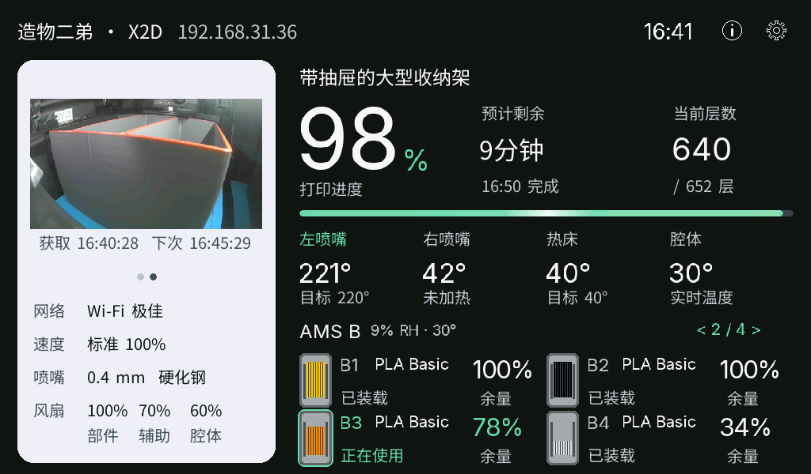
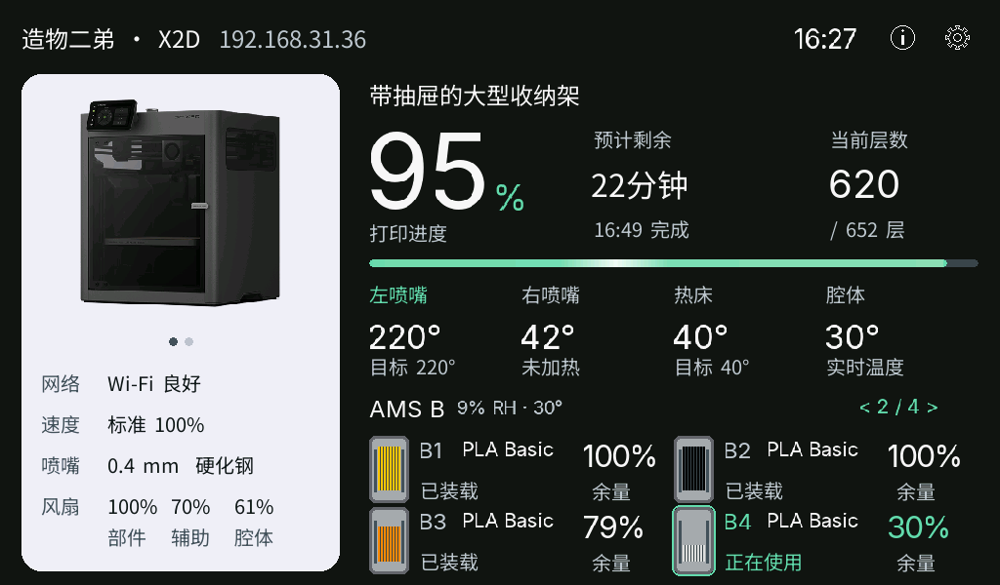
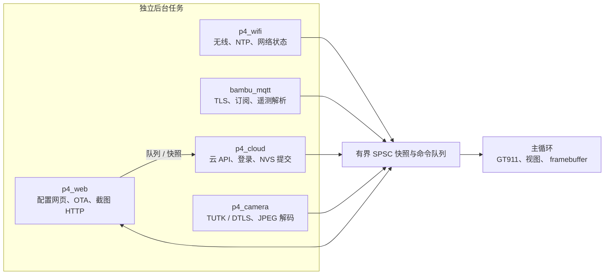

# BambuHelper for ESP32-P4

面向 **Waveshare ESP32-P4-WIFI6-Touch-LCD-7B** 的 Bambu Lab 打印机触控看板。
1024 × 600 中文界面、独立后台网络任务，以及无需电脑或 NAS 的云端打印实景。

这个分支按 P4 的显示、内存和交互需求独立演进，不维护原项目的小屏设备与旧版布局。
打印机状态来自 Bambu Lab MQTT；项目不提供切片、打印控制或摄像头直播功能。



*Rev1.3 实板的原生 1024 × 600 截图：云端 X2D 实时打印数据、舱内实景和 AMS 状态。*

## 看板与操作

- **打印概览**：任务名称、大号进度、渐变进度条与移动高光、预计剩余时间、完成时间和当前层数。
- **打印参数**：左右喷嘴、热床和腔体温度，网络、速度、喷嘴规格与三路风扇状态。
- **AMS / 耗材**：四料槽一页，显示耗材颜色、类型、装载状态、余量、温湿度和正在使用的料槽；支持 AMS、AMS HT 和外挂耗材。
- **机型图 / 实景切换**：点击或左右滑动左侧图片区切换；图片框、圆点和下方信息保持固定位置。
- **详情页**：右上角 info 进入任务、耗材、设备、提醒四页；顶部箭头返回。提醒页可上下滑动，详情 60 秒无操作自动返回。
- **AMS 翻页**：默认跟随正在使用的 AMS；点击标题箭头或在右侧耗材区左右滑动后，保持用户选中的页面。
- **多台打印机**：点击首页顶部名称区域切换，支持最多两台同时连接的打印机。
- **看板设置**：齿轮页显示本机配置网址和二维码；网页可修改 Wi-Fi、打印机、显示、亮度及通知设置。

没有上报的温度、料槽余量等数据显示为未知，不会把真实 `0` 当成缺省值。AMS 没有数据时，
提示在整个耗材区域内居中显示。

## 云端打印实景

看板可以直接取得当前打印机舱内的一张真实 JPEG，**不需要 Bambu Studio 插件、
电脑截图服务、NAS、视频解码器或 RTSP 转发**。

| 没有实景 / 启动回退 | 已取得当前任务实景 |
| --- | --- |
|  |  |

- 开机尚未取得实景时显示内置机型图，首张当前任务实景到达后自动切换；用户手动选择不被后台刷新覆盖。
- 首页可见且联网时自动刷新，成功后 **5 分钟**一次；失败独立指数退避，保留最后一张有效图片。
- 实景下方显示实际获取时间与下一次更新时间，不将旧图片伪装成刚刚获取。
- 图片按原比例完整缩放，不裁切画面；按打印机序列号、任务和打印盘匹配，避免旧任务图片混入新任务。
- 当前实现为 Rev1.3 / pre-v3 芯片的实景构建。固件保留 `P4_CLOUD_CAMERA_EXPERIMENTAL`
  编译标识，仅在已验证的打印机、固件和区域范围内使用。
- 云端实景需要额外的应用签名凭据。它不是仅粘贴 Bambu token 就能使用的公开接口；
  配置接口、字段和开发工具见 [云端实景配置](docs/P4-CAMERA-RESEARCH.md)。不要提交 token、
  私钥、连接票据、NVS 备份或真实腔体图片。

## 架构

P4 版本不把所有工作放进一个 Arduino 主循环。**渲染主循环不发起网络请求、
MQTT、HTTPS 或 NVS 操作**；外部工作由各自后台任务完成，通过完整快照交换状态。



- Wi-Fi、MQTT、云端 API 和实景分别恢复；云端或实景失败不会重建正常的 Wi-Fi。
- SPSC 邮箱只发布完整快照；正在读取的缓冲区不被生产者覆盖，快照读写不互相等待。
  需要可靠顺序的命令使用 FreeRTOS 队列。
- 画面、触摸和视图状态只属于 UI；网页截图在面板绘制完成后复制一帧，不创建持续截图流水线。
- 大图像、网络数据、邮箱槽及可放入外部内存的执行栈使用 PSRAM；**FreeRTOS TCB
  始终使用内部 RAM**。NVS 与 Flash 写入任务的执行栈也保留在内部 RAM。
- 短期 HTTPS 与 TUTK/DTLS 由独立实景任务执行；辅助 TLS 互斥不等待，失败有退避，
  任务名称查询不会阻塞图片显示或触摸。

完整启动、网络恢复、快照、缓冲区所有权与上板验收时序见
[P4 运行时序](docs/P4-RUNTIME-SEQUENCE.md)。

## 硬件与连接

| 项目 | 当前支持 |
| --- | --- |
| 开发板 | Waveshare ESP32-P4-WIFI6-Touch-LCD-7B |
| 显示 / 触摸 | EK79007 MIPI-DSI，1024 × 600 / GT911 |
| 存储 | 32 MB Flash、32 MB PSRAM |
| 无线 | 板载 ESP32-C6，通过 ESP-Hosted / SDIO 连接 |
| 打印机 | 已实测中国区云端 X2D；LAN / Cloud MQTT 代码仍可选，其他型号需实测 |
| 音频 | ES8311 提示音接口已接入，完整通知场景未作为本版验收项 |

microSD、板载摄像头采集、RS485、CAN 和麦克风不属于当前看板功能。无线连接只需刷写 P4，
不要随应用固件重刷 ESP32-C6。

## 构建与刷机

使用 Python 3.10–3.14 和 PlatformIO。P4 工具链固定为 pioarduino `55.03.311` /
Arduino-ESP32 `3.3.11`，先确认芯片版本再选环境。

| 芯片 / 功能 | PlatformIO 环境 | 发布镜像 |
| --- | --- | --- |
| Rev1.3 / pre-v3，云端实景 | `ws_p4_lcd_7b_rev1_camera` | `BambuHelper-ws_p4_lcd_7b_rev1_camera-v4.0.1-*.bin` |
| Rev3.1+，云端实景 | `ws_p4_lcd_7b_camera` | `BambuHelper-ws_p4_lcd_7b_camera-v4.0.1-*.bin` |

正式发布时，在 `main` 更新 `FW_VERSION` 后推送同名 `vX.Y.Z` tag。GitHub Actions 会自动编译两种芯片版本，生成 Full / OTA 与 SHA256 校验文件，并创建 GitHub Release；无需手动上传固件。

```sh
# 本机 Rev1.3：编译、USB 刷写与日志
pio run -e ws_p4_lcd_7b_rev1_camera
pio run -e ws_p4_lcd_7b_rev1_camera -t upload --upload-port /dev/你的串口
pio device monitor -b 115200 --port /dev/你的串口
```

`Full.bin` 用于完整 USB 恢复，从地址 `0x0` 写入；`ota.bin` 用于相同芯片版本、
相同实景构建的手动网页 OTA。**不能跨芯片版本或跨有无实景的构建进行 OTA。**
OTA 当前不是无人值守升级：已验证的路径是保留 NVS 的 USB 刷写。刷机不需要擦除整片 Flash。

本版不包含上游 Web Flasher 或其他设备镜像。详细引脚、镜像地址、分区与硬件限制见
[P4 安装和硬件说明](docs/ESP32-P4-7B.md)。

## 验证与诊断

```sh
python3 -m unittest discover -s tests -v
cmake -S tools/p4_preview -B .cache/p4-preview-build
cmake --build .cache/p4-preview-build -j 4
.cache/p4-preview-build/p4_preview .cache/p4-preview
```

设备网页提供只读诊断：`/status`、`/debug`、`/camera/status`，以及按需生成一帧的
`/screen.bmp?scale=1`。桌面预览使用合成数据；`docs/images/` 中的看板图来自真实设备截图。

Rev1.3 已实测 USB 刷入、Wi-Fi、中国区 MQTT、触控、AMS、云端实景、机型图回退和
5 分钟刷新计划。Rev3.1+ 只进行编译验证。双打印机、LAN 摄像头、通知音、真实断网恢复和
长时间运行不因此自动视为全部通过。

## 来源与许可

项目最初基于 [Keralots/BambuHelper](https://github.com/Keralots/BambuHelper)，当前分支的
P4 看板、云端实景与运行时架构独立维护。界面构图参考所有者认可的 BambuDroid 设计。

Bambu Studio 打印机图片及 `lib/BambuTUTK` 传输模块使用 AGPL-3.0；包含该模块的固件
须遵守对应许可。Noto Sans SC 字体使用 SIL OFL，耗材图形保留 ISC 许可。来源与完整声明见
[assets/p4/NOTICE.md](assets/p4/NOTICE.md)、[lib/BambuTUTK/NOTICE.md](lib/BambuTUTK/NOTICE.md)
和 [docs/licenses/](docs/licenses/)。
