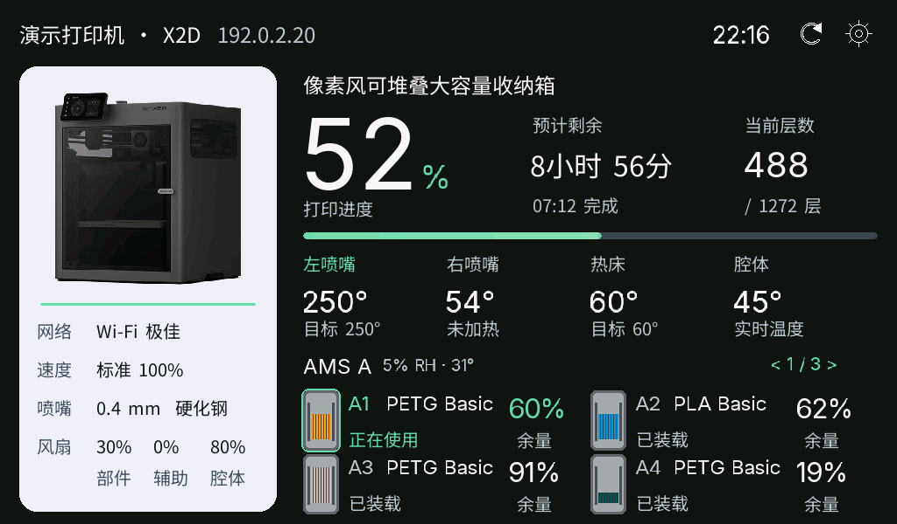

# Waveshare ESP32-P4-WIFI6-Touch-LCD-7B

本适配针对微雪 **7B / EK79007 1024×600** 开发板，32 MB Flash、32 MB PSRAM、
GT911 触摸，以及通过 SDIO 连接的 ESP32-C6 无线协处理器。
其他 P4 屏幕型号需要各自的屏幕时序和引脚配置。

## 编译与烧录

使用 Python 3.10–3.14 和 PlatformIO。此板型单独固定在 pioarduino `55.03.311`
（Arduino-ESP32 `3.3.11`），与厂商 Arduino 示例一致；其他板型仍使用原有工具链。
首次构建需要下载 P4 工具链和预编译库。

本机全局 `pio` 若使用 Python 3.15，可在项目内使用独立环境：

```sh
python3.14 -m venv .pio-core/venv
.pio-core/venv/bin/python -m pip install platformio
source .pio-core/venv/bin/activate
```

| 实际芯片版本 | 构建环境 | 说明 |
| --- | --- | --- |
| Rev3.1 及以上 | `ws_p4_lcd_7b` | 默认 production P4 库 |
| Rev1.3 / pre-v3 | `ws_p4_lcd_7b_rev1` | 使用 `esp32p4_es` 库 |

请先按实际芯片版本选择环境。厂商特别说明：菜单中的 post-v3 不代表恰好 Rev3.0
的样片能运行 production 库；编译成功不能替代芯片版本检查。

```sh
pio run -e ws_p4_lcd_7b
pio run -e ws_p4_lcd_7b -t upload --upload-port /dev/你的串口
pio device monitor -b 115200 --port /dev/你的串口
```

Rev1.3 将上述环境名称替换为 `ws_p4_lcd_7b_rev1`。串口按本机实际设备修改，
使用板载 USB-Serial/JTAG 烧录连接。Arduino 日志和 Improv 配网使用同一 USB 串口。

生成可分发的固件：

```sh
python merge_bins.py --board ws_p4_lcd_7b
# Rev1.3:
python merge_bins.py --board ws_p4_lcd_7b_rev1
```

输出位于 `firmware/<版本>/`：`Full.bin` 是从地址 `0x0` 写入的完整镜像，
其中 P4 bootloader 在 **`0x2000`**，分区表在 `0x8000`，应用在 `0x10000`。
`ota.bin` 仅用于已安装对应板型固件的手动 OTA 上传。
两个芯片版本使用不同的固件文件名和板型标识，更新时保持所选环境一致。
GitHub 的 P4 专项 Release 会分别附上两个芯片版本的 `Full.bin` 与 `ota.bin`。
P4 使用对应板型的 `ota.bin` 在网页中手动更新，尚未加入上游的设备内一键更新源。

32 MB 分区表包含两个 13 MB OTA 槽和剩余的数据分区。首次安装或切换分区表时使用
USB 完整烧录。此板型尚未加入网页烧录器和自动发布列表，自动在线更新未开启。

## 已接入功能

- EK79007 MIPI-DSI：双 lane、1000 Mbit/s、52 MHz DPI 时钟，HSYNC 10/160/160，
  VSYNC 1/23/12。显示由原生 RGB565 PSRAM framebuffer 驱动，按更新区域回写缓存。
- 原生 1024×600 横屏仪表盘：六个仪表、大字体、配网页、打印状态、时钟与 HMS。
  面板安装方向默认补偿 180°；设置中的 0° 是补偿后的默认方向，180° 再翻转一次。
  导入配置中的 90° / 270° 会归一到横屏。
- GT911：I2C SDA=7 / SCL=8，轮询 `0x5D`，兼容 `0x14` 地址；不驱动 INT/RST。
  沿用现有点击、长按和唤醒手势。
- 背光：GPIO32，低电平有效，5 kHz PWM，支持亮度、夜间模式和灭屏。
- ESP32-C6 Wi-Fi：由 Arduino 的 ESP-Hosted 提供，保留原有热点配网、Improv、
  MQTT、云登录和网页配置流程。
- ES8311 扬声器：I2C `0x18`，MCLK=13、BCLK=12、LRCK=10、DOUT=9，功放使能=53。
  使用现有声音通知设置。
- LED / 外接按钮 / GPIO 蜂鸣器：默认不分配 GPIO，并对用户配置和已有 NVS 中的
  引脚进行检查，保护屏幕、音频、无线、USB、启动和存储接口。

无线 SDIO 引脚为 CLK=18、CMD=19、D0=14、D1=15、D2=16、D3=17、C6 reset=54。
正常安装只烧录 P4，C6 保留现有出厂固件，无需预先修改或重刷。此次适配没有修改
C6 固件，普通 P4 应用烧录也不会更新 C6。当前尚无实板日志表明需要更新 C6；
如果实际出现无线初始化失败，再根据 ESP-Hosted 连接/版本日志排查兼容性。

## 显示与触摸操作

- 默认 Cards 采用与 BambuDroid 安卓应用一致的构图：左侧浅色打印机面板；右侧任务名、
  大进度、剩余时间、层数、温度；底部两行 AMS。顶部依次显示名称、型号与打印机 IP。
  首页、待机和完成状态使用同一布局，中文使用抗锯齿 P4 Sans 字库。
- 点任务区进入任务详情，点耗材区进入耗材详情，点左侧打印机面板进入设备详情。
  详情顶部提供任务 / 耗材 / 设备 / 提醒四页；点标签切页，左右滑动也可切页。
  耗材详情内左右滑动切换 AMS；提醒页上下滑动查看更多。顶部返回箭头回首页，
  详情 60 秒无操作自动返回。首页出现提醒时可点“提醒”直接查看。
- 首页 AMS 标题右侧箭头或左右滑动切换 AMS 组，不自动跳离正在查看的组。
  支持 AMS HT、外挂和超过四组 AMS 的已存储信息；没有上报/保存的料槽数据明确显示未知。
  余量只显示真实百分比，不假设整卷重量。有效 0% 湿度正常显示。
- 点顶部名称区域切换已配置的打印机；刷新图标发送一次状态请求，5 秒防连点；
  断线时点刷新会立即尝试恢复网络或 MQTT，不必再断电重启；
  齿轮打开配置入口，显示本机网址及二维码，继续使用现有网页修改网络、亮度与样式。
  触摸释放时执行操作；多指、总线错误、超时触点及唤醒触摸不会变成页面点击。
- 网页 Print screen 仍可选择 Gauges；六/八仪表、AMS 总览及可配置的整屏手势继续可用。
  网页的 Switch device status / AMS page 仍打开完整 AMS 总览。
- 喷嘴、热床、腔温和风扇区分“未上报”与真实的 0；双喷嘴规格按挤出机 id 缓存，
  增量上报不清空另一侧。新看板使用 PSRAM 帧缓存及静态图片缓存，重复数据不会重绘整屏。
- P4 固定显示内置的打印机图片，不下载云端模型图，也不创建取图任务或第二条 TLS
  会话。避免并行云端取图影响 ESP-Hosted 的无线连接；其他板型的预览功能不变。
- 双打印机分屏为左右两个面板，各显示四个仪表；保留自动轮换与 PSRAM 板型的
  可选四打印机模式。
- 进度条使用青绿渐变和局部移动高光，只更新该小条带，不刷新整屏。
  现有 P1/A1 局域网摄像头继续由 Gauges 使用。远程舱内取流调研见 [摄像头说明](P4-CAMERA-RESEARCH.md)。
- 截图接口支持完整 1024×600；慢速网络可用 `/screen.bmp?scale=3` 获取完整画面的缩小预览，
  或 `/screen.bmp?header=1` 获取原分辨率标题区域，避免完整 BMP 传输超时。
  `/debug` 提供触摸坐标、帧数、按压/读错误计数、看板页面及可用 PSRAM。

microSD、板载摄像头采集、麦克风、RS485 和 CAN 没有对应的 BambuHelper 业务功能。

### 新看板预览（合成数据）



上图由固件实际 C++ 绘图代码、同一字库和 PNG 解码器在桌面生成，使用合成数据。
复现方式见 [native preview](../tools/p4_preview/README.md)。

2026-10-26 在 Rev1.3 实板烧录验证新看板，云端打印数据恢复，设置与返回由用户点击确认。
GT911 原始坐标在默认方向已与画面一致；仅用户设置 180° 时翻转坐标。
顶部继续显示打印机 IP，名称、型号和 IP 使用相同 24px 字体并共用垂直中轴；
看板自身 IP 在设置入口显示。进度数字使用 112px 字体，顶端与右侧指标标签对齐，
其余数值行、说明行和温度行采用统一水平中轴。左侧固定为网络 / 速度 / 喷嘴 / 风扇，
四行间距 44px，标签和值使用同一套 20px 字体；喷嘴直径与材质合并在同一行。
实机截图用于核对标题/IP 对齐和布局。AMS 无数据时提示在整个耗材区域内居中。
AMS 标题与上下内容按实际字形边界保留相同空白，不受中英文不同字体的行高影响。
首页第二行耗材向上收紧，底部留白与左侧打印机面板一致。

112px VLW 字体的绘制会在栈上临时分配整块字形位图；实板首次收到打印数据后曾触发
8KB `loopTask` 栈保护。P4 单独将主循环栈配置为 24KB，其他板型保持原值。
`/debug` 的 `loop_stack_min_bytes` 是 ESP-IDF 返回的历史最小剩余栈字节数，用于实板验证余量。

## 中国区云配置

实板已使用 `bambulab.cn` 登录 Cookie 中的 `token` 值连接中国区云端；仅填写该字段的值，
不要粘贴整段 Cookie。区域选择 China/CN。使用 My printers 返回的序列号，避免手工漏字：
MQTT 连接成功仅证明已登录云端，不代表所订阅的序列号正确。当前 API 使用中国区域名，
MQTT 为 `cn.mqtt.bambulab.com:8883`。

## 验证边界

已在 Rev1.3 实板验证屏幕、180° 方向、Wi-Fi、中国区 MQTT 实时打印数据与 GT911 按压事件，以及两台 AMS 2 的准确湿度（包含 0%）。
Cards、AMS 总览、料槽条和截图按实板渲染结果检查。生产版芯片环境另做编译验证。
当前只有一台云端 X2D 可供测试；双打印机分屏、LAN 摄像头、通知音与 OTA 的完整运行流程
仍需对应设备或场景验证，不能把编译通过等同于这些场景全部实测。
若点屏初始化失败，固件会关闭背光并在串口报告失败步骤，避免继续访问空 framebuffer。

配置测试使用 `python -m unittest discover -s tests`，覆盖 OTA 分区边界、P4 ROM
bootloader 地址、保留 GPIO、屏幕旋转、GT911 坐标读取/错误/超时、多指取消、滑动与
唤醒抑制、AMS 零值与增量合并、喷嘴规格按 id 合并。桌面预览另验证页面命中与渲染。

P4 新字体与机型图片只链接到两个 P4 环境；各自仍须使用对应芯片版本的固件。
素材、字体来源和许可证见 [assets/p4/NOTICE.md](../assets/p4/NOTICE.md)。

引脚和时序来自用户提供的厂商资料库：
`examples/arduino/libraries/displays/displays_config.h`、
`examples/arduino/libraries/GFX_Library_for_Arduino/src/databus/Arduino_ESP32DSIPanel.cpp`、
`examples/arduino/examples/09_Audio_Playback/` 和 `examples/arduino/README_ZH.md`。
另见[微雪官方文档](https://docs.waveshare.net/ESP32-P4-WIFI6-Touch-LCD-7B/)
和 [pioarduino 55.03.311](https://github.com/pioarduino/platform-espressif32/releases/tag/55.03.311)。
