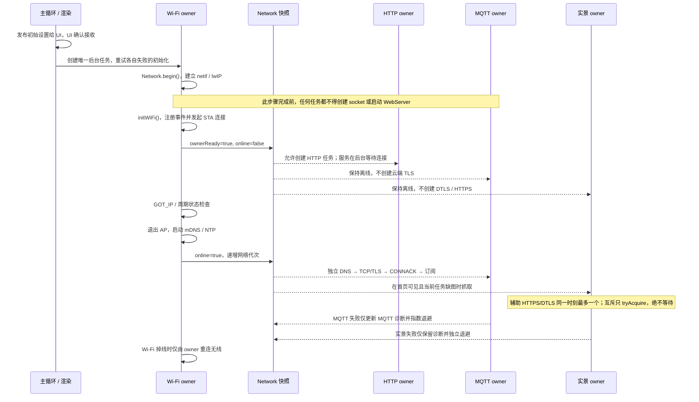
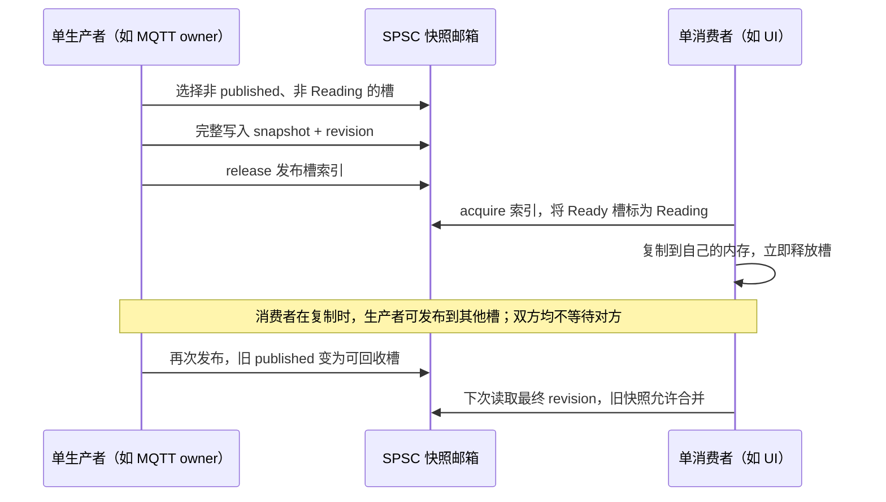
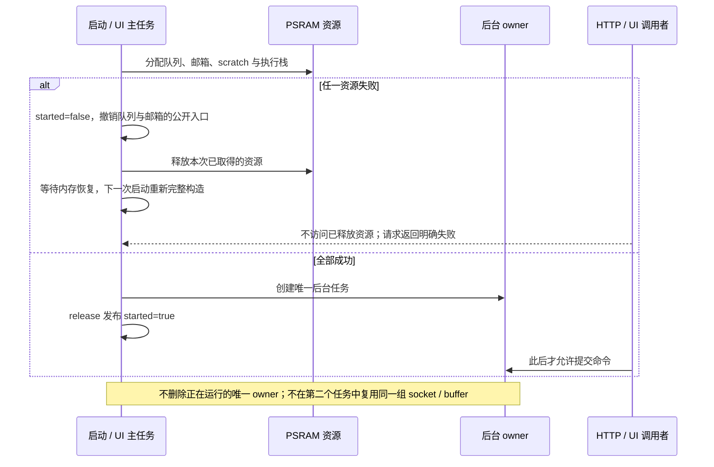
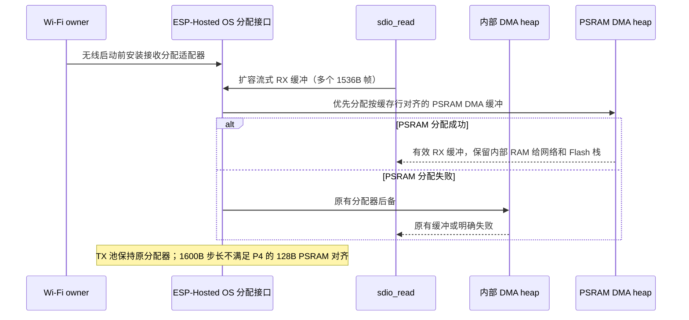
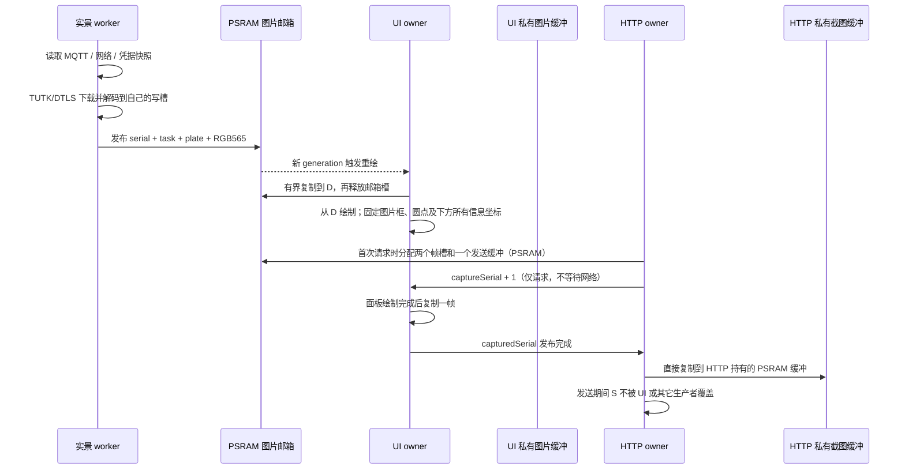

# ESP32-P4 运行时序与缓冲区所有权

本文是实现约束，不是“任务已经拆开”的架构宣传。P4 的渲染主循环不得调用
MQTT、HTTP/HTTPS、NVS 或 Wi-Fi Arduino API。所有外部请求都属于指定后台任务。
无线连接、云端 MQTT 和实景协议是三个独立故障域；任何一类失败都不得通过重启
设备或重建正常 Wi-Fi 来“恢复”另一类服务。

## 启动与网络恢复

`Network.begin()` 失败不是正常离线状态。此时发布 `ownerReady=false`，Wi-Fi
owner 按有限退避重试初始化；不得删除唯一 owner 后永久失去网络控制。HTTP 任务
只在 owner 就绪后创建，创建动作有持续重试，不存在“只调用一次，失败后永远没有
端口 80”的路径。MQTT 和实景必须同时检查 `ownerReady && online && !ap && !ota`。

云端 TLS、MQTT 认证、订阅和实景失败不会调用 Wi-Fi transport rebuild。只有
Wi-Fi owner 的无线状态机可以重连；取消 MQTT 连续失败两次就断开 Wi-Fi 的旧策略。

## 快照与命令

邮箱每个实例只有一个生产者和一个消费者。消费者复制期间，生产者不能回收该槽；
旧 published 可以合并，但最终 revision 必须可读。消费者复制完成后若槽仍是当前
published，恢复为 Ready；否则标为 Free，生产者可以回收它。重新发布当前槽时
不得把自己退休。`readNext` 只在 revision 变化时返回 true，空读不得消费未来 revision。
命令若需要可靠完成、顺序或应答，使用 FreeRTOS queue，不用最新值邮箱伪装可靠队列。
所有后台等待必须有明确的所有者和退出路径。

## 初始化失败与回收

启动时先完整分配核心设置邮箱，再发布初始配置。每个 worker 只有构造成功后才
对外发布 `started`，失败时可以重新初始化，不能只重置标志而泄漏旧队列或栈。
实景 worker 的每个 `beginWrite()` 都有配对完成或取消；截图则有作用域守卫覆盖
尺寸异常、邮箱繁忙等所有提前返回。未成功解码的图片不发布，不覆盖旧的有效帧。

辅助云 HTTPS 与实景 HTTPS/DTLS 使用 `P4AuxTransportGate` 做非等待互斥；MQTT
不参与该互斥。辅助连接占用时，另一后台任务跳过本次调度并稍后重试。时钟未同步、
内存不足或抓图失败均有退避，不能连续消耗连接和内部 RAM。诊断阶段以
`first_core`、`mqtt_published`、`ui_received`、`dashboard_frame` 依次验证
首份打印数据从解析到首页的传递，不能用 AMS 日志代替完整打印数据的验收。

MQTT 心跳还要同时记录 socket 状态、请求全量状态的次数、接收字节/完整包计数，
Wi-Fi 心跳记录实际 IP 和 netif 状态位，HTTP owner 记录服务循环心跳。这样可以
区分“无线已关联”“socket 已认证”“完整报文已解析”和“UI 已显示”四种状态。
内部 RAM 的总空闲量和最大连续块均需观察；图片和大快照应使用 PSRAM，不能靠
大量空闲 PSRAM 推断 Wi-Fi/SDIO 所需的内部 RAM 充足。
MQTT、实景凭据/协议和云端抓图的 ArduinoJson 文档共用分配策略：初始大块
使用 PSRAM，小对象留在内部 RAM，扩容纳同一内存区域；PSRAM 分配失败时解析失败，
不转为消耗最后的内部 RAM 储备。释放沿用块头记录的分配区域，失败路径释放整棵文档。

### SDIO 接收内存（当前 Arduino 3.3.11 / ESP-Hosted 2.12.11）

这是固定版本 SDK 的接收分配适配，不能通过只改应用编译宏来假装改过预编译驱动。
只对 `sdio_read` 的流式数据缓冲优先使用 PSRAM DMA，寄存器和 TX 池仍走原接口；
缓冲沿用 SDK 的 `free()` 释放规则。适配器安装后不再修改，后台只记录原子计数。
SDK 更换版本时必须重新核对分配入口、任务名、DMA 对齐和释放接口。
背景与上游复现见 [ESP-Hosted #243](https://github.com/espressif/esp-hosted-mcu/issues/243)、
[TX 对齐 #219](https://github.com/espressif/esp-hosted-mcu/issues/219)。

### 启动分配与界面交互边界

Arduino 在 `initArduino()` 才将 PSRAM 加入 heap；P4 邮箱的全局构造不能分配槽。
槽由唯一生产者在首次发布时从 PSRAM 分配，并由 published 索引的 release/acquire
发布给消费者；未发布前消费者不读取槽指针。读取竞争时保留上次有效网络/打印状态，
不能把一次邮箱读取失败转换为无线离线、清零或销毁 MQTT 会话。
`readNext` 先在已认领槽上检查版本，未变化时不复制整份数据；亮度、提示音等一次性
命令只能消费一次。UI 状态仅在变化时及每秒一次重新发布，栈水位每秒采样一次。

首页图片区的点击和横滑只改变图片选择；AMS 横滑只在右侧耗材矩形内生效。
图片、圆点、网络/速度/喷嘴/风扇行使用同一组固定坐标，不能根据源图尺寸重新排版。
实景在校时完成且具备内部内存预算后才启动；接口分别报告当前等待条件和上次抓图结果。
当前任务缺图时，网络和 MQTT 就绪即可首次抓取，不等待首个五分钟周期；只有失败
才进入缺图退避。已有当前任务图片才按五分钟周期刷新。
实景 worker 只消费一次凭据 revision；已有图片的匹配键由该 worker 自己保存，
不回读 UI 专用图片邮箱。UI 只在图片 generation 改变时复制 RGB565 缓冲。
下载/解码/任务名查询全部留在 worker，触摸切换只切换已经缓存的图片或加载提示。
每帧携带成功解码的获取时间；下一次刷新时刻由同一个实景调度器在本次请求结束后
发布。UI 只格式化本地时间并绘制，不为了时间文案轮询外部接口。刷新失败保留旧帧
及其原始获取时间，下一次计划、抓取中和当前等待条件单独显示。

P4 的预编译 SDK 默认让 Mbed TLS 只用内部内存。两个并存 TLS 会话会把 AES
DMA 描述符也需要的区域耗尽，出现 `esp-aes: Failed to allocate memory for the
array of DMA descriptors`。运行时在任何 TLS 会话创建前，通过
`mbedtls_platform_set_calloc_free()` 安装一次固定策略：大于等于 2KB 的 TLS
缓冲优先使用按缓存行对齐的 PSRAM DMA 内存，小对象继续使用内部 RAM。
两种内存均由 `heap_caps_free()` 释放，分配乘法和对齐加法均检查溢出。
不在活动连接中修改全局分配策略，也不通过降低证书验证或断开 MQTT 来腾空间。

### Flash 操作的任务栈

NVS 提交和 OTA 写入会临时关闭 Flash cache。`p4_cloud`（NVS owner）和 `p4_web`
（手动 OTA owner）的任务栈必须是内部 RAM；不能因为大临时数据已搬入 PSRAM，
就把它们的执行栈也放在 PSRAM。否则 SDK 会在写入前以
`esp_task_stack_is_sane_cache_disabled()` 断言中止。云任务保留 16KB 内部栈、
Web 任务保留 12KB 内部栈，大设置/请求/响应/图片继续在 PSRAM。
MQTT、Wi-Fi、实景任务不写本地 Flash，可使用 PSRAM 栈。验收必须实际保存配置，
并同时观察任务栈最小余量，不能只测试读取 `/status`。

HTTP 命令进入云工作线程；无论成功、失败或异常都要结束 pending。Wi-Fi 配置只在
Wi-Fi owner 内应用；保存配置由存储 owner 完成后，再发布新的只读配置快照。
后台任务及其失败重试只由 `p4RuntimeStartWorkers()` 触发，HTTP 任务不得重复创建或
清理云和实景服务。存储写入使用独立完成序号；只有网页保存请求携带重启票据，
实景凭据等后台写入不得创建、完成或取消该票据。

## 实景、绘制与截图

UI 大图的临时值不得放在 32KB 任务栈上。实景协议只负责抓图，任务名查询是独立
步骤；名称超时不能撤销已经成功的图片。首张当前任务实景到达时，若用户未明确
选择机型图，则显示实景；用户选择保持到主动切换或更换打印机。切换图片只改变
视图选择，不能触发布局重新测量。AMS 默认跟随使用中的单元，用户手动翻页后保持。
截图使用两个槽：当旧帧仍被 HTTP 复制时，UI 的写入尝试立即返回并在后续循环重试；
确认序号必须是开始复制时的请求，不能把复制过程中到达的新请求误标为已完成。
截图前无需预留全屏缓冲；首次请求后才保留两个帧槽和一个发送缓冲。

TUTK 回调是实景数据的唯一写入者，完成后以 release 标记发布；摄像头任务 acquire
后才读取并移动结果。等待期间只检查完成、连接和截止时间，连接提前断开即可退出，
不会为一个已经结束的连接持有互斥锁或继续等待完整超时时间。协议错误只记录分类，
不记录回复正文或凭据。内部 RAM/PSRAM 的抓图最低值是阶段边界采样，不等同于整个
TLS 操作期间的精确最小值。

## 所有权表

| 数据 / 操作 | 唯一写入者 | 读者与复制规则 |
| --- | --- | --- |
| Arduino `WiFi`、AP/STA、mDNS | `p4_wifi` | 其它任务只读 `P4NetworkStatus` 快照 |
| MQTT socket、解析中的 `BambuState` | `bambu_mqtt` | 分别复制到 UI / HTTP / 实景邮箱 |
| 云登录、云 API、NVS 设置提交 | `p4_cloud` | HTTP 队列请求；快照返回结果 |
| 实景下载、JPEG 解码、邮箱写槽 | `p4_camera` | UI 复制到私有 PSRAM 后才绘制 |
| 面板 framebuffer、视图、触摸 | 主循环 / UI | HTTP 请求截图，不能直接触摸面板 |
| `/screen.bmp` 发送缓冲 | `p4_web` | UI 邮箱直接复制到该 PSRAM 缓冲 |
| WebServer 与 socket 客户端 | `p4_web` | 网络未初始化前任务不创建 socket |

## 上板验收门槛

1. 强制交错测试覆盖读取中连续发布、最终命令不丢、同 revision 不重复消费；
   主机测试和 TSAN 通过。
2. 桌面预览验证首张实景、手动切换、固定布局和 AMS 跟随/保持；P4 串行构建通过。
3. USB 烧录保留 NVS。串口确认 Wi-Fi 初始化、获得 IP、MQTT 各阶段，不仅检查是否重启。
4. `/status` 与 `/screen.bmp` 可用；路由器断网/恢复、云端连接失败/恢复分别验证，
   确认云端故障不重建 Wi-Fi。
5. 实景成功、协议失败、慢任务名三种情况分别验证，确认旧图不会被失败清空，
   渲染触摸持续响应。
